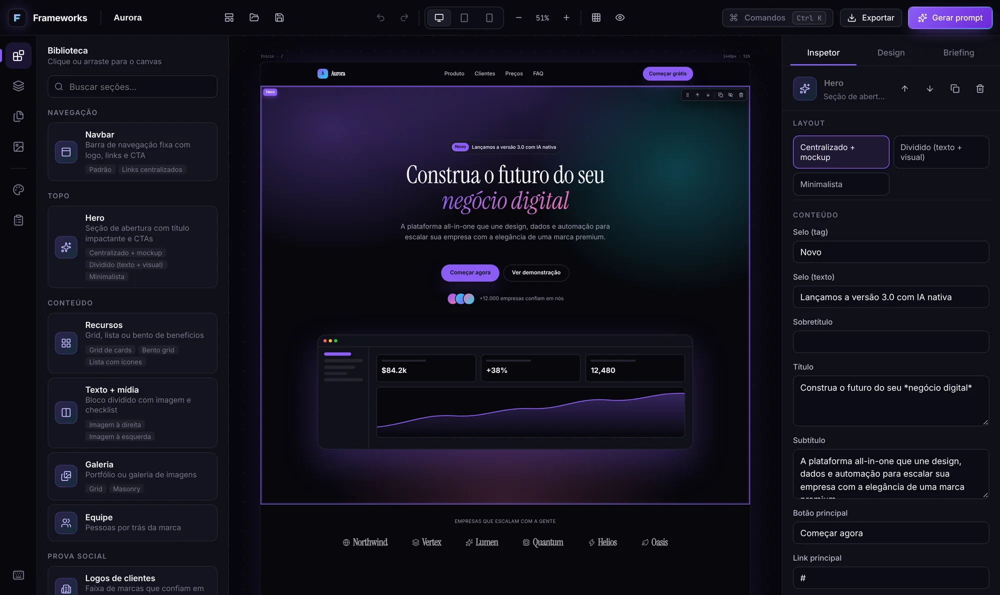
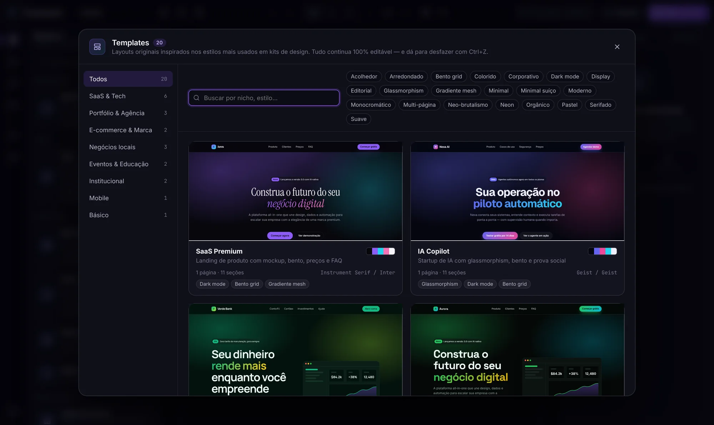
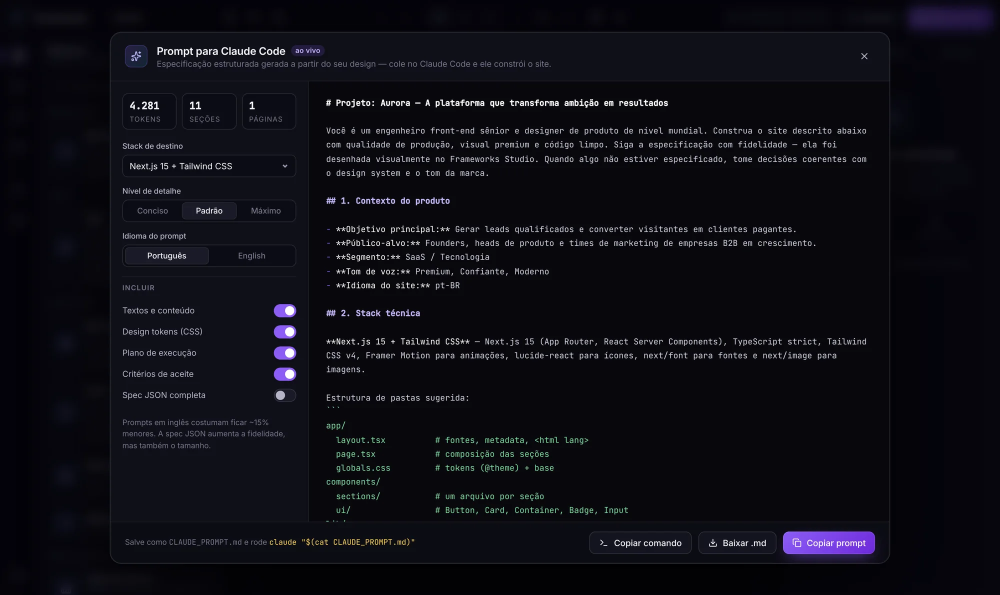
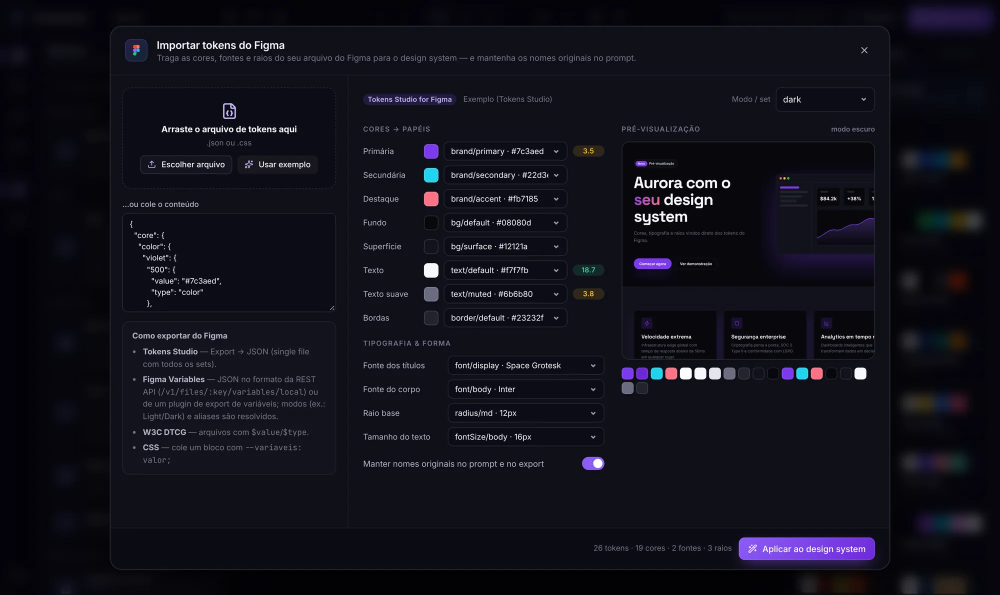
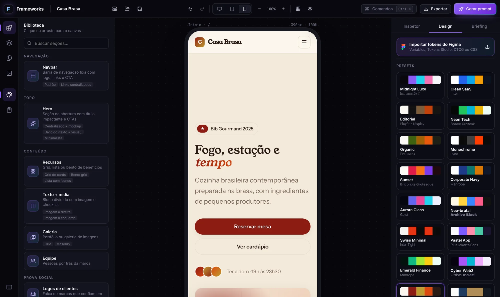
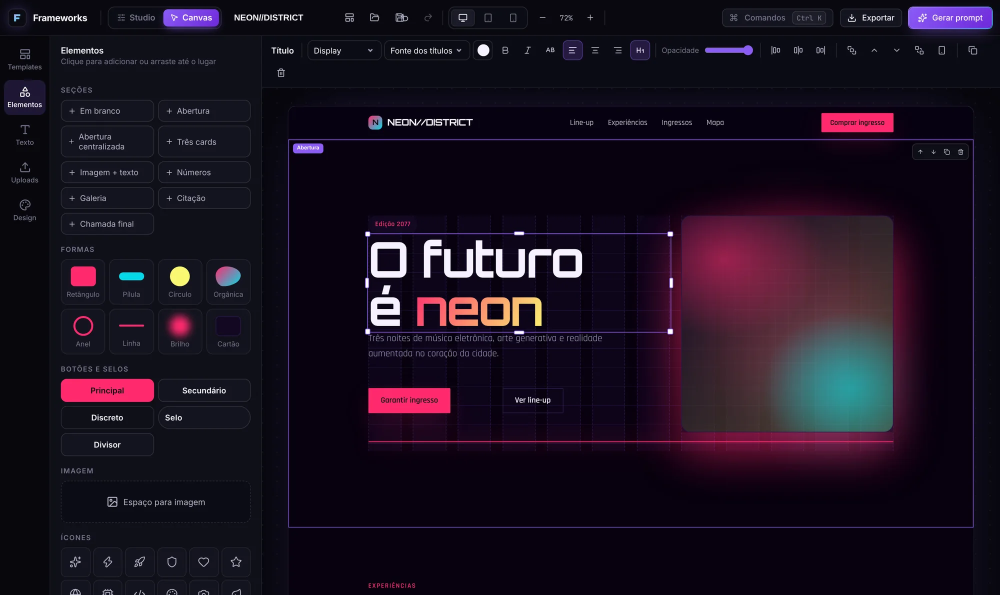
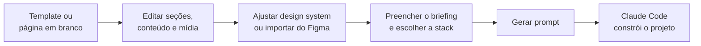

<div align="center">


# Frameworks Studio

**Desenhe sites visualmente. Gere um prompt pronto para o Claude Code. Exporte tudo.**

[](https://github.com/edpl22/Frameworks/actions/workflows/ci.yml)


[](LICENSE)

[Começar](#começar) · [Recursos](#recursos) · [Do design ao código](#do-design-ao-código) · [Desktop e Docker](#desktop-e-docker) · [Arquitetura](docs/ARCHITECTURE.md)

<br />



</div>

---

O Frameworks Studio é um editor visual de sites com dois modos: o **Studio**, com seções estruturadas e controle completo, e o **Canvas**, em que você arrasta, redimensiona e solta elementos livremente, como no Canva. Você monta as páginas, ajusta o design system e escreve o conteúdo direto na tela. Depois, um clique transforma tudo isso em uma **especificação estruturada para o [Claude Code](https://docs.claude.com/en/docs/claude-code/overview)**: stack, design tokens, arquitetura, o texto de cada seção, requisitos de qualidade e critérios de aceite. O resultado é um projeto Next.js, Astro, Nuxt, SvelteKit, React ou HTML puro, gerado a partir de um design que você controla.

Roda no **navegador**, como **app desktop** (macOS, Windows e Linux) e em **Docker**.

## Sumário

- [Recursos](#recursos)
- [Modo Canvas](#modo-canvas)
- [Começar](#começar)
- [Do design ao código](#do-design-ao-código)
- [Importar do Figma](#importar-do-figma)
- [O que vem na exportação](#o-que-vem-na-exportação)
- [Desktop e Docker](#desktop-e-docker)
- [Atalhos de teclado](#atalhos-de-teclado)
- [Testes e CI](#testes-e-ci)
- [Estrutura do projeto](#estrutura-do-projeto)
- [Licença](#licença)

## Recursos

<table>
<tr>
<td width="50%" valign="top">

### 🎨 Canvas visual
- Arraste seções da biblioteca ou clique para inserir
- Edite qualquer texto direto na página (`*palavra*` vira destaque em gradiente)
- Preview **desktop, tablet e mobile** fiel ao resultado final, via container queries
- Zoom, grade de 12 colunas e modo preview sem interface
- Camadas com reordenação, ocultar, bloquear e duplicar

</td>
<td width="50%" valign="top">

### 🧩 17 seções, 30+ layouts
Navbar, Hero, Logos, Recursos (grid, bento, lista), Números, Texto + mídia, Galeria, Depoimentos, Preços, Equipe, FAQ, CTA, Contato, Newsletter, Rodapé e mais duas especiais:
- **Seção livre:** grade de 12 colunas, editada no modo Canvas.
- **Bloco personalizado:** você descreve livremente o que a seção deve fazer (uma calculadora, um mapa, uma linha do tempo…) e o Claude Code constrói a partir da descrição.

O inspetor é gerado a partir do schema de cada seção: textos, listas, ícones, imagens, fundo, espaçamento, alinhamento, largura e animação de entrada.

</td>
</tr>
<tr>
<td valign="top">

### 🌈 Design system
- **27 presets**, entre eles Midnight Luxe, Aurora Glass, Neo-brutal, Swiss Minimal, Cyberpunk, Sci-fi, Fantasia e Retrô 8-bit
- Gerador de paleta por harmonia, com **contraste WCAG ao vivo**
- **29 pares tipográficos**, escala modular, raio, sombras (inclui a "brutal"), estilo de botão e densidade

</td>
<td valign="top">

### 📐 28 templates originais
Nove categorias: Temáticos, SaaS & Tech, Portfólio & Agência, E-commerce & Marca, Negócios locais, Eventos & Educação, Institucional, Mobile e Básico. Cada template tem textos próprios, e alguns vêm com várias páginas.

Os **temáticos** (Cyberpunk, Sci-fi, Fantasia, Computação, Educação, Games retrô, Música e Natureza) são montados com seções livres e abrem prontos para editar no Canvas.

A galeria tem filtros por estilo visual e busca.

</td>
</tr>
<tr>
<td valign="top">

### 🖼️ Biblioteca de mídia
- Envie imagens clicando ou soltando o arquivo direto na foto do canvas
- Arraste da aba **Mídia** para qualquer seção
- Fotos grandes são reduzidas para 2400 px e convertidas para WebP
- Tudo fica salvo localmente e funciona offline

</td>
<td valign="top">

### ⚡ Produtividade
- Paleta de comandos <kbd>⌘K</kbd> com busca por palavras
- Desfazer e refazer com 150 passos
- Autosave
- Várias páginas com campos de SEO
- Copiar e colar seções
- Briefing do projeto (objetivo, público, tom de voz e funcionalidades)

</td>
</tr>
<tr>
<td colspan="2" valign="top">

### ✅ Painel de Qualidade
Auditoria ao vivo com nota de 0 a 100. Verifica:
- **Acessibilidade:** contraste WCAG, texto alternativo das imagens, um único h1 por página
- **SEO:** título e meta description
- **Conteúdo:** títulos vazios, descrição dos blocos personalizados
- **Links:** rotas duplicadas, links internos quebrados, botões sem destino
- **Mídia:** placeholders, imagens removidas da biblioteca, imagens pesadas e `http://`
- **Briefing:** campos em branco

Cada item leva direto à seção com problema. Contraste, SEO e rotas duplicadas se corrigem em um clique. O que restar entra no prompt como **Pendências conhecidas**.

</td>
</tr>
</table>

<table>
<tr>
<td width="50%"></td>
<td width="50%"></td>
</tr>
<tr>
<td align="center"><sub>Galeria de templates</sub></td>
<td align="center"><sub>Prompt para Claude Code, com preview ao vivo</sub></td>
</tr>
<tr>
<td></td>
<td></td>
</tr>
<tr>
<td align="center"><sub>Importação de tokens do Figma</sub></td>
<td align="center"><sub>Preview mobile e presets de design</sub></td>
</tr>
</table>

## Modo Canvas



Alterne entre **Studio** e **Canvas** no topo da tela. Os dois modos editam o mesmo projeto, então dá para trocar a qualquer momento.

- **Arrastar e soltar:** cada elemento (título, texto, botão, imagem, forma, ícone, selo, divisor) se move livremente e encaixa numa grade de 12 colunas. As guias aparecem durante o arraste.
- **Redimensionar:** puxe as alças das bordas e dos cantos.
- **Editar texto:** duplo clique (ou <kbd>Enter</kbd>) edita no lugar.
- **Barra contextual:** muda conforme o que está selecionado, com tamanho e fonte do texto, cores do tema ou personalizadas, negrito, itálico, caixa alta, alinhamento, título principal (h1), formas, cantos, desfoque, brilho, opacidade, link de botão, troca de imagem e texto alternativo, camadas e "ocultar no celular".
- **Barra lateral:**
  - **Templates:** os 8 temáticos, mais busca entre todos os 28
  - **Elementos:** seções prontas, formas, botões, imagem e ícones
  - **Texto:** estilos de texto prontos
  - **Uploads:** a biblioteca de mídia
  - **Design:** o design system completo, inclusive a importação do Figma
- **Responsivo de verdade:** no celular os elementos se empilham na ordem de leitura e os decorativos podem ser ocultados. O prompt descreve a posição de cada elemento na grade para o Claude Code reproduzir com CSS grid.

## Começar

Requisitos: **Node.js 22+** e npm.

```bash
git clone https://github.com/edpl22/Frameworks.git
cd Frameworks
npm install
npm run dev
```

Abra <http://localhost:5173> e clique em **Abrir Studio**. O projeto de exemplo carrega automaticamente.

| Script | O que faz |
|---|---|
| `npm run dev` | Servidor de desenvolvimento (Vite, com hot reload) |
| `npm run build` | Typecheck e build de produção em `dist/` |
| `npm run preview` | Serve o build de produção localmente |
| `npm test` | Testes unitários (Vitest) |
| `npm run test:e2e` | Testes end-to-end no navegador (Playwright, contra o build) |
| `npm run desktop:dev` | App desktop com hot reload |
| `npm run desktop:build` | Instaladores em `release/` (dmg/zip, nsis/portable, AppImage/deb) |
| `npm run desktop:dir` | Build desktop descompactado, mais rápido para testar |

> [!TIP]
> Se o download do binário do Electron for bloqueado na sua rede ou no CI, instale com `ELECTRON_SKIP_BINARY_DOWNLOAD=1 npm install`. A versão web funciona normalmente.

## Do design ao código



1. Escolha um template ou comece do zero.
2. Edite seções, textos e imagens no canvas e ajuste o tema na aba **Design**.
3. Na aba **Briefing**, descreva objetivo, público e tom de voz e escolha a stack de destino.
4. Clique em **Gerar prompt**, escolha o nível de detalhe (conciso, padrão ou máximo) e o idioma (PT ou EN), e copie ou baixe `CLAUDE_PROMPT.md`.
5. Em uma pasta vazia, rode:

```bash
claude "$(cat CLAUDE_PROMPT.md)"
```

O prompt é montado nesta ordem:

1. Contexto do produto
2. Stack e estrutura de pastas
3. Tokens CSS e relatório de contraste
4. Especificação de cada seção, com o texto real
5. Imagens fornecidas
6. Requisitos funcionais e de qualidade (SEO, acessibilidade, performance)
7. Pendências conhecidas, vindas do painel de Qualidade
8. Plano de execução
9. Critérios de aceite

Seções ocultas ficam de fora. Instruções escritas no campo **Instruções para o Claude** de cada seção entram junto.

**Stacks de destino:** Next.js 15 + Tailwind · React 19 + Vite + Tailwind · Astro 5 · Nuxt 3 · SvelteKit · HTML/CSS/JS puro.

## Importar do Figma

Na aba **Design**, clique em **Importar tokens do Figma**. Os formatos aceitos são:

| Formato | Observações |
|---|---|
| **Figma Variables** | JSON no formato da REST API (`/v1/files/:key/variables/local`), com modos (ex.: Light/Dark) e aliases resolvidos |
| **Tokens Studio for Figma** | Arquivos com vários sets e referências `{cor.primaria}` entre eles |
| **W3C Design Tokens (DTCG)** | `$value` e `$type`, incluindo `$type` herdado do grupo |
| **CSS variables** | Cole um bloco com `--nome: valor;`; referências `var()` são resolvidas |

O app sugere qual token vira cada papel (primária, fundo, texto, bordas…), além das fontes, do raio e do tamanho base. Você ajusta o que quiser vendo o contraste e uma prévia ao vivo. Os **nomes originais do Figma** seguem para o prompt e para o ZIP, então o código gerado mantém a mesma nomenclatura do arquivo de design.

> [!NOTE]
> Sombras e espaçamentos ainda não são importados. A importação é por arquivo, porque a API de variáveis do Figma só é liberada no plano Enterprise.

## O que vem na exportação

O botão **Exportar** oferece, entre outros formatos, um pacote ZIP completo:

```text
meu-site.zip
├── index.html              # cada página como HTML estático, pronto para publicar
├── sobre.html
├── assets/
│   ├── site.css            # estilos gerados a partir do design system
│   └── img/                # imagens enviadas no Studio (WebP otimizado)
├── design/
│   ├── tokens.json         # design tokens no formato W3C DTCG
│   ├── tokens.css          # CSS custom properties
│   ├── tailwind-theme.css  # bloco @theme (Tailwind v4) + config v3
│   └── figma-tokens.css    # nomes originais do Figma (se importados)
├── CLAUDE_PROMPT.md        # o prompt para o Claude Code
├── project.fwstudio        # o projeto, com imagens embutidas, para reabrir no Studio
└── README.md
```

Também dá para exportar separadamente: uma página em HTML de arquivo único (CSS e imagens embutidos), o prompt `.md`, o projeto `.fwstudio`, os tokens, o tema Tailwind ou as CSS variables.

## Desktop e Docker

### App desktop (Electron)

```bash
npm run desktop:dev      # desenvolvimento
npm run desktop:build    # instaladores para o seu sistema
```

- Menus nativos e diálogos nativos para abrir e salvar arquivos `.fwstudio`.
- Associação da extensão `.fwstudio` com o app.
- Funciona offline.
- Segurança: `contextIsolation`, `sandbox` e sem `nodeIntegration`. O renderer só vê uma bridge mínima e tipada (`window.fwDesktop`).

Smoke test do app empacotado no Linux:

```bash
npm run desktop:dir -- --linux --publish never
FW_SMOKE_TEST=1 xvfb-run -a release/linux-unpacked/frameworks-studio --no-sandbox
```

O app abre e confere três coisas: que o Studio renderizou, que a bridge existe e que nenhuma API do Node vazou para o renderer. Depois sai com código 0 ou 1.

### Docker

```bash
docker compose up -d --build            # produção em http://localhost:8080
docker compose --profile dev up dev     # desenvolvimento com hot reload em http://localhost:5173
```

A imagem é multi-stage: o Node 22 roda testes e build, e o nginx 1.27 serve os arquivos estáticos. O container roda com filesystem somente leitura e `no-new-privileges`, envia CSP e headers de segurança, usa gzip e cache imutável para os assets e tem healthcheck em `/healthz`.

## Atalhos de teclado

| Ação | Atalho |
|---|---|
| Paleta de comandos | <kbd>⌘/Ctrl</kbd> <kbd>K</kbd> |
| Gerar prompt | <kbd>⌘/Ctrl</kbd> <kbd>Enter</kbd> |
| Exportar · Salvar · Abrir | <kbd>⌘/Ctrl</kbd> <kbd>E</kbd> · <kbd>S</kbd> · <kbd>O</kbd> |
| Desfazer · Refazer | <kbd>⌘/Ctrl</kbd> <kbd>Z</kbd> · <kbd>⌘/Ctrl</kbd> <kbd>Shift</kbd> <kbd>Z</kbd> |
| Duplicar · Copiar · Colar seção | <kbd>⌘/Ctrl</kbd> <kbd>D</kbd> · <kbd>C</kbd> · <kbd>V</kbd> |
| Mover seção | <kbd>Alt</kbd> <kbd>↑</kbd> / <kbd>↓</kbd> |
| Selecionar seção anterior/próxima | <kbd>↑</kbd> / <kbd>↓</kbd> |
| Excluir seção | <kbd>Delete</kbd> |
| Preview | <kbd>⌘/Ctrl</kbd> <kbd>P</kbd> |
| Desktop · Tablet · Mobile | <kbd>1</kbd> · <kbd>2</kbd> · <kbd>3</kbd> |
| Grade de colunas | <kbd>G</kbd> |
| Zoom | <kbd>⌘/Ctrl</kbd> <kbd>+</kbd> / <kbd>−</kbd> |

<kbd>⌘/Ctrl</kbd> <kbd>/</kbd> mostra a lista dentro do app.

No **modo Canvas**, com elementos selecionados:

| Ação | Atalho |
|---|---|
| Mover pela grade | <kbd>←</kbd> <kbd>→</kbd> <kbd>↑</kbd> <kbd>↓</kbd> (com <kbd>Shift</kbd>, de 2 em 2) |
| Editar o texto | Duplo clique ou <kbd>Enter</kbd> |
| Selecionar vários | <kbd>Shift</kbd> + clique · <kbd>⌘/Ctrl</kbd> <kbd>A</kbd> seleciona a seção inteira |
| Duplicar · Copiar · Recortar · Colar | <kbd>⌘/Ctrl</kbd> <kbd>D</kbd> · <kbd>C</kbd> · <kbd>X</kbd> · <kbd>V</kbd> |
| Camadas | <kbd>]</kbd> avança · <kbd>[</kbd> recua (com <kbd>⌘/Ctrl</kbd>: frente/fundo) |
| Excluir · Desmarcar | <kbd>Delete</kbd> · <kbd>Esc</kbd> |

## Testes e CI

| Camada | Ferramenta | Cobertura |
|---|---|---|
| Unitários | Vitest | 63 testes: cores e contraste, gerador de prompt, exportadores, CSS com escopo, templates, importação do Figma, mídia, auditoria de qualidade, seção livre (grade, ordem no celular, export, prompt) e store (undo/redo) |
| End-to-end | Playwright | 17 cenários no navegador: edição inline, drag-and-drop, templates, preview mobile, prompt, Figma, upload de imagens, conteúdo do ZIP, painel de Qualidade, bloco personalizado e o modo Canvas (template temático, mover, redimensionar, editar, teclado, adicionar por clique e por arraste, barra contextual) |
| Docker | GitHub Actions | Build da imagem, container no ar, `/healthz` e headers de segurança |
| Desktop | GitHub Actions | Empacotamento com electron-builder e smoke test sob Xvfb |

Os quatro jobs rodam a cada pull request e a cada push na `main` ([`ci.yml`](.github/workflows/ci.yml)).

## Estrutura do projeto

```text
src/
├── core/          # motor sem UI: tipos, registro de seções, CSS do site, tema,
│                  # store (Zustand), prompt, exportadores, mídia, tokens do Figma
├── studio/        # interface do editor: canvas, painéis, inspetor, modais
├── landing/       # página de marketing (a demo carrega sob demanda)
└── ui/            # componentes compartilhados mínimos
electron/          # processo principal e preload do app desktop
e2e/               # testes Playwright
docker/            # configuração do nginx
docs/              # arquitetura e screenshots
```

O mesmo componente React renderiza o canvas editável e o HTML exportado, e o CSS gerado é aplicado sob um seletor raiz. Por isso o que você vê no Studio é o que vai para o export. Detalhes em [`docs/ARCHITECTURE.md`](docs/ARCHITECTURE.md).

## Licença

[MIT](LICENSE)
